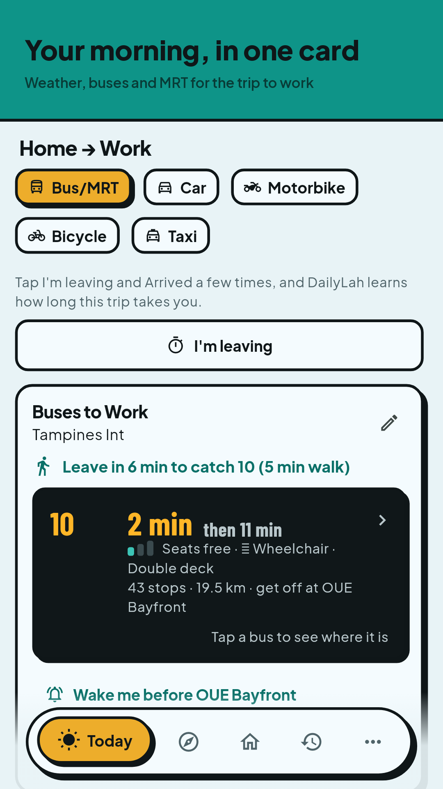
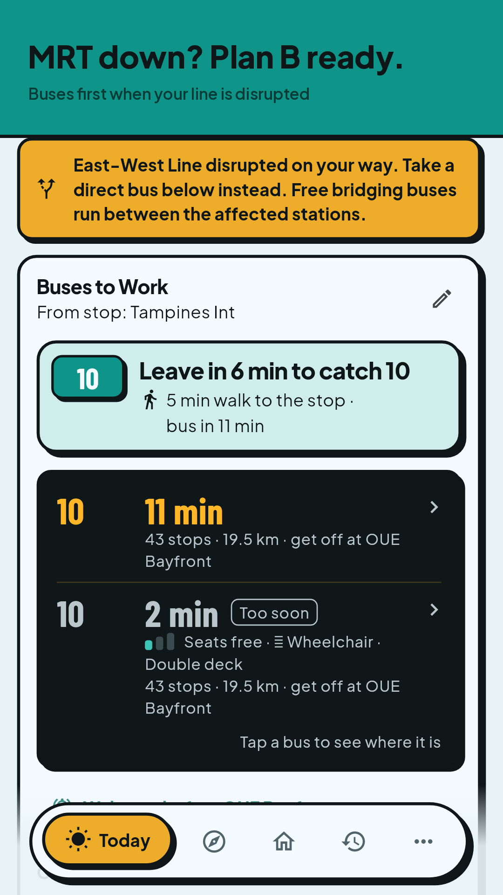
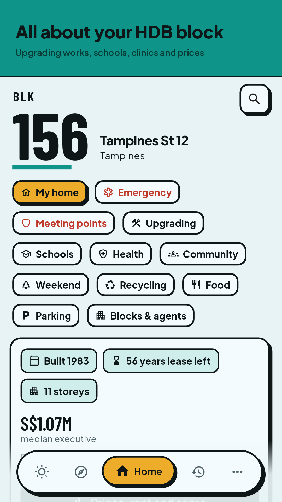
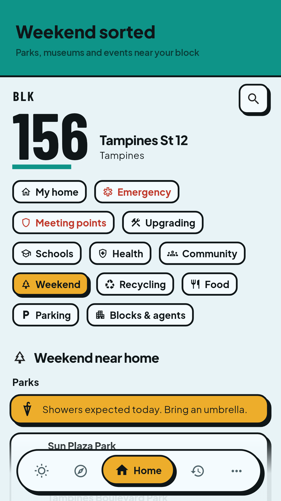

# DailyLah


Know before you go lah. DailyLah is a free Android app for people living in Singapore. It turns
open data from data.gov.sg and LTA DataMall into one morning card, one evening card, and only the
alerts that matter: the next buses at your stops, MRT disruptions, rain before you leave, and
what is around your HDB block.

No account, no tracking. Saved places stay on the phone, and alerts are made on the device.

**Status:** on [Google Play](https://play.google.com/store/apps/details?id=com.tursinalabs.dailylah) (public since 11 Nov 2026). Website: [dailylah.sg](https://dailylah.sg).

[](https://github.com/hndrwn-dk/dailylah/tags)
[](https://dailylah.sg)
[](https://github.com/hndrwn-dk/dailylah/actions/workflows/web-check.yml)

The version badge shows the latest build sent to Google Play. The dailylah.sg badge checks the
site when the page loads. `web-check` runs every morning at 07:23
Singapore time and also checks the policy redirects and the data manifest on all three hosts
([docs/QA.md](docs/QA.md), "Web check").

<p>
  
  
  
  
</p>

## Repository layout

| Path | What it holds |
| --- | --- |
| `app/` | Flutter app (Riverpod, dio), released on Android |
| `backend/` | Python 3.12 FastAPI service that polls the upstream APIs |
| `web/` | Static site on Vercel: landing page, "Where to live?", data bundles |
| `contracts/v1/` | One example per `/v1/*` endpoint, checked by both app and backend tests |
| `docs/` | QA and release process, deploy steps, code index, legal text, store assets |
| `scripts/` | Ops scripts: app ID check, release signing, data push, repo map |
| `.github/workflows/` | CI/CD: tests, emulator runs, security scans, Play upload, daily data |

## Documentation

| Read this | For |
| --- | --- |
| [`docs/QA.md`](docs/QA.md) | Every test layer, required checks, security scans, and how a release ships |
| [`docs/REPO_MAP.md`](docs/REPO_MAP.md) | Every file in `app/lib`, every provider and endpoint (generated) |
| [`CLAUDE.md`](CLAUDE.md) / [`AGENTS.md`](AGENTS.md) | Rules for AI coding agents, plus [`app/CLAUDE.md`](app/CLAUDE.md) and [`backend/CLAUDE.md`](backend/CLAUDE.md) |
| [`docs/legal/`](docs/legal/) | Source of the published privacy policy and terms |
| [`docs/DEPLOY.md`](docs/DEPLOY.md) | Setting up Render, Upstash, Neon, Vercel, the data workflow and secrets |

## Stack

| Part | Tech | Hosting (free tier) |
| --- | --- | --- |
| App | Flutter, Riverpod, dio | Google Play |
| API | Python 3.12, FastAPI | Render |
| Poll scheduler | Upstash QStash | Upstash |
| Real-time cache | Upstash Redis | Upstash |
| Static and spatial data | PostgreSQL + PostGIS | Neon |
| Website, data bundles | Static HTML/JSON, no build step | Vercel |
| Alerts | On-device (WorkManager, local notifications) | none |

Upstream data: data.gov.sg (NEA, HDB, CEA), LTA DataMall, OneMap, URA and Geoapify.

## Quick start

### Backend

```bash
cd backend
python -m venv .venv && source .venv/bin/activate
pip install -r requirements-dev.txt
cp .env.example .env        # fill in the keys (docs/DEPLOY.md); leave QSTASH_* empty locally
pytest && ruff check . && ruff format --check .
uvicorn app.main:app --reload
curl -X POST localhost:8000/internal/poll
curl localhost:8000/v1/weather/forecast
```

### App

The platform folders are committed, so there is nothing to generate.

```bash
cd app
flutter pub get --enforce-lockfile
flutter analyze && flutter test
flutter run --dart-define=API_URL=http://10.0.2.2:8000   # Android emulator → local API
```

App ID (Android and iOS) is **`com.tursinalabs.dailylah`** and is permanent.
`scripts/check-app-id.sh` enforces it in CI. If the platform folders ever need regenerating, use
only the `flutter create` command in [`CLAUDE.md`](CLAUDE.md).

### Web

```bash
node --test 'web/tests/*.test.mjs'          # Node 22, no packages
```

The 360 px layout test in a real browser is in [`CLAUDE.md`](CLAUDE.md) under Commands.

## How a release ships

Pull requests that touch the app run the app tests (including a screen matrix, golden images and
API contracts) and emulator tests on Android 10, 15 and 16. Every pull request runs the security
scans (CodeQL, osv-scanner, zizmor). Nine checks are required on `main`; docs/QA.md
"Required checks" lists them.

A push to `main` that raises `version:` in `app/pubspec.yaml` becomes a release:

1. The AAB is built without signing keys, then signed in a separate job.
2. The emulator tests run again on that commit, including an upgrade from the last release tag
   and the R8 release build, and 10 Maestro flows run on an APK made from the signed AAB.
3. It is uploaded to closed testing on Google Play, and the commit is tagged `v<version>`.

Production is a manual run that needs approval and arrives in Play Console as a draft. The full
process, including the checklist before production, is in [`docs/QA.md`](docs/QA.md).

## Deploy

Setting up the hosted services (Render, Upstash, Neon, Vercel), the daily data workflow and their
secrets: [`docs/DEPLOY.md`](docs/DEPLOY.md).

## Contributing and security

This is a personal project. Changes go through one pull request per batch, squash-merged into
`main`, using [the PR template](.github/pull_request_template.md).

Found a security issue? Please don't open a public issue. Email support@tursinalabs.com instead.

## Data and license

Data from data.gov.sg, LTA DataMall, OneMap and URA. Not affiliated with the Singapore Government.
A Tursina Labs project.

Copyright (c) 2026 Hendrawan Daryono Karso (Tursina Labs). All rights reserved. The source is public
to read; no licence is granted to use or redistribute it. See [LICENSE](LICENSE).
