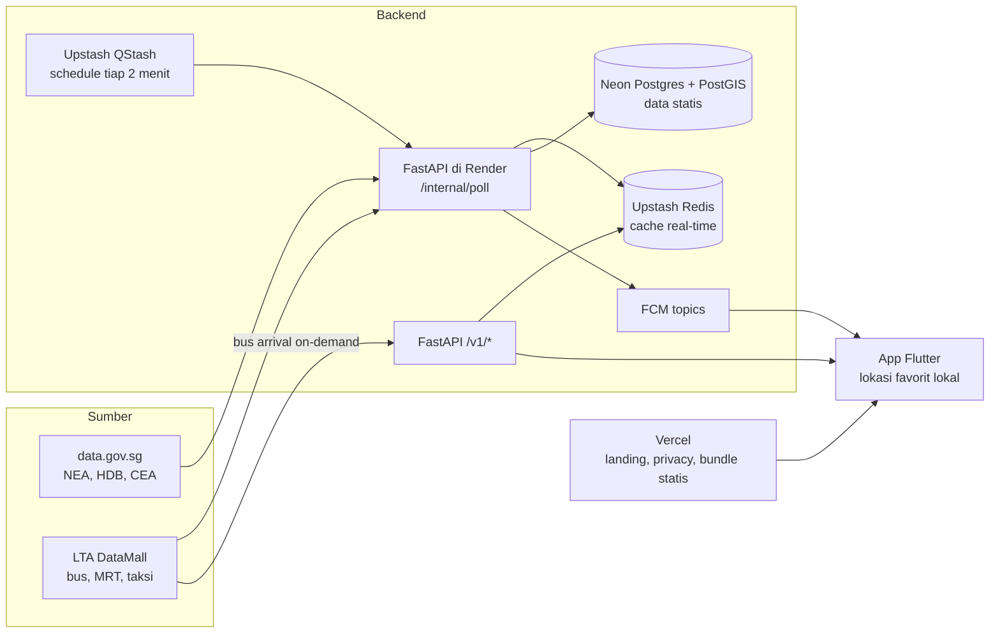

# DailyLah — PRD v0.1 (Mode Lokal)

Oct 19, 2026 · @Hendrawan

## Ringkasan

DailyLah adalah app mobile gratis untuk warga Singapura yang menggabungkan data terbuka pemerintah (data.gov.sg) dan LTA DataMall menjadi satu asisten harian yang proaktif. Pengguna cukup menyimpan lokasi rumah, kantor, dan sekolah anak sekali saja. Setelah itu app memberi tahu hal yang penting tepat pada waktunya: bus datang, MRT terganggu, hujan sebentar lagi, hawker langganan tutup, atau ada cluster dengue di dekat rumah.

**Masalah:** informasi harian tersebar di banyak app terpisah (bus, cuaca, NEA, HDB). Semuanya harus dibuka manual, padahal yang dibutuhkan hanya beberapa kabar relevan untuk rutinitas sendiri.

**Solusi:** satu app yang membaca rutinitas pengguna, lalu menyaring dan menggabungkan data lintas agensi menjadi kartu pagi, kartu sore, dan notifikasi singkat.

**Target pengguna:** penduduk dan pekerja di Singapura yang setiap hari memakai transport publik, terutama keluarga dengan anak usia sekolah. Mode turis sengaja tidak masuk scope versi ini. Informasi sewa dan beli HDB masuk sebagai Modul Rumah, karena keputusan tempat tinggal sangat terikat dengan kehidupan sehari-hari di sekitarnya.

## Tujuan & non-tujuan

Tujuan utamanya adalah membuat pengguna membuka app setiap hari karena informasinya relevan, bukan karena kebiasaan menggulir.

**Tujuan**

- Satu kartu pagi dan satu kartu sore yang cukup dibaca dalam 5 detik
- Notifikasi proaktif yang jarang tapi tepat sasaran (lihat bagian Aturan notifikasi)
- Setup awal di bawah 2 menit: izin lokasi, lalu 2–3 lokasi favorit
- Gratis tanpa iklan yang mengganggu, sejalan dengan app Tursina Labs lainnya

**Non-tujuan (v1)**

- Mode turis atau pengunjung
- Navigasi turn-by-turn atau perencana rute lengkap seperti Google Maps atau Citymapper
- Pembayaran, booking taksi, transaksi apa pun, atau listing properti aktif
- Akun pengguna dan login, karena semua preferensi disimpan di perangkat

**Metrik keberhasilan (usulan, target angka masih perlu diputuskan)**

| Metrik | Kenapa penting |
| --- | --- |
| Retensi D7 dan D30 | Membuktikan app memang dipakai harian |
| Persentase user yang membuka kartu pagi minimal 4 hari/minggu | Indikator inti nilai harian |
| Rasio notifikasi dibuka vs dimatikan | Mengukur apakah notifikasi tepat atau justru mengganggu |
| Rating Play Store | Sinyal kualitas dan sumber akuisisi organik |

## Persona & skenario harian

Ada dua persona utama. Keduanya tinggal di HDB dan berbagi lokasi favorit dalam satu rumah tangga.

| Persona | Rutinitas | Kebutuhan utama |
| --- | --- | --- |
| Pekerja komuter | Bus ke MRT, kantor di CBD, pulang jam sibuk | Bus dan MRT tepat waktu, info gangguan, hujan saat pulang |
| Orang tua pengurus rumah | Antar-jemput anak sekolah, belanja, hawker, aktivitas akhir pekan | Cuaca dan panas untuk anak, dengue di sekitar, hawker buka, ide akhir pekan |

**Satu hari bersama DailyLah**

1. **06.45, kartu pagi:** prakiraan cuaca 2 jam, status jalur MRT yang biasa dipakai, dan bus berikutnya di halte dekat rumah beserta tingkat kepadatannya.
2. **07.20, notifikasi:** gangguan di jalur MRT langganan, lengkap dengan info shuttle bus dan saran berangkat lebih awal.
3. **11.30, siang:** hawker langganan tutup untuk pembersihan, jadi app menyarankan hawker terdekat yang buka.
4. **14.00, notifikasi untuk orang tua:** heat stress (WBGT) tinggi di sekitar sekolah anak.
5. **17.30, kartu sore:** prakiraan kepadatan stasiun untuk memilih jam pulang, alert hujan, dan bus dari halte dekat kantor.
6. **21.00, malam:** cluster dengue baru dalam radius rumah, plus info hawker yang tutup besok.
7. **Sabtu pagi:** saran kegiatan keluarga sesuai cuaca, misalnya taman kalau cerah atau perpustakaan kalau hujan.

## Sumber data

Semua data berasal dari dua sumber resmi: [data.gov.sg](https://data.gov.sg/agencies) dan [LTA DataMall](https://datamall.lta.gov.sg/content/datamall/en/dynamic-data.html). LTA DataMall butuh API key gratis. Kolom Status menandai dataset yang field dan frekuensi update-nya belum dicek langsung.

| Dataset | Sumber | Jenis | Dipakai untuk | Status |
| --- | --- | --- | --- | --- |
| Bus Arrival (ETA, lokasi, kepadatan) | LTA DataMall | Real-time | Kartu pagi/sore, notifikasi bus | Terkonfirmasi |
| Bus Stops, Bus Routes, Bus Services | LTA DataMall | Statis | Data offline halte & rute | Terkonfirmasi |
| Train Service Alerts | LTA DataMall | Event | Notifikasi gangguan MRT/LRT | Terkonfirmasi |
| Platform Crowd Density (real-time & prakiraan 30 menit) | LTA DataMall | Real-time | Saran jam pulang | Terkonfirmasi |
| Taxi Availability | LTA DataMall | Real-time | Info taksi saat hujan | Terkonfirmasi |
| Carpark Availability (HDB, LTA, URA) | LTA DataMall / data.gov.sg | Real-time | Fitur parkir | Terkonfirmasi |
| Prakiraan cuaca 2 jam, curah hujan, UV, PSI/PM2.5 | NEA via data.gov.sg | Real-time | Kartu cuaca, alert hujan | Cek field |
| WBGT (heat stress) dan petir | NEA via data.gov.sg | Real-time | Alert panas dan petir | Cek ketersediaan |
| Cluster dengue | NEA via data.gov.sg | Berkala | Alert dengue, skor sekitar blok | Cek frekuensi update |
| Hawker centre dan jadwal tutup | NEA via data.gov.sg | Berkala | Hawker planner, skor sekitar blok | Cek field |
| Harga resale flat HDB | HDB via data.gov.sg | Berkala | Modul Rumah: harga per blok | Cek field |
| Data sewa flat HDB | HDB via data.gov.sg | Berkala | Modul Rumah: sewa | Cek field |
| Info properti HDB per blok | HDB via data.gov.sg | Statis | Modul Rumah: profil blok | Cek field |
| Registry agen properti | CEA via data.gov.sg | Berkala | Modul Rumah: cek agen | Cek field |
| Preschool dan direktori sekolah | ECDA, MOE | Statis | Lokasi sekolah anak, skor sekitar blok | Cek field |
| Taman, perpustakaan, CC, fasilitas olahraga | NParks, NLB, PA, SportSG | Statis | Weekend planner | Cek field |
| Dataset MUIS | MUIS | Statis | Modul Muslim | Cek isi |

Bus Arrival, Train Service Alerts, dan Platform Crowd Density tercantum di [halaman dynamic data LTA DataMall](https://datamall.lta.gov.sg/content/datamall/en/dynamic-data.html). Taxi Availability dan Flood Alerts tercantum di [wrapper ltasg](https://pypi.org/project/ltasg/) yang mengacu ke LTA DataMall API User Guide v6.8.

## Fitur & requirement per fase

MVP fokus ke transport dan cuaca karena keduanya dipakai setiap hari. Fitur lain ditambahkan setelah retensi harian terbukti.

### Fase 1: MVP (transport + cuaca)

- **Onboarding:** izin lokasi dan notifikasi, lalu simpan 2–3 lokasi favorit (Rumah, Kantor, Sekolah) beserta halte bus dan jalur MRT yang biasa dipakai
- **Kartu pagi:** cuaca 2 jam di lokasi saat ini, status jalur MRT favorit, dan 2 bus berikutnya di halte favorit beserta kepadatannya
- **Kartu sore:** sama seperti kartu pagi, ditambah prakiraan kepadatan stasiun untuk 1–2 jam ke depan
- **Bus arrival on-demand:** cari halte terdekat atau dari daftar favorit, data halte tersimpan offline
- **Alert gangguan MRT** untuk jalur favorit
- **Alert hujan** untuk lokasi favorit di jam yang relevan
- **Widget layar utama Android** untuk kartu aktif

### Fase 2: lingkungan sekitar

- **Hawker planner:** simpan hawker langganan, peringatan sebelum jadwal tutup, saran hawker terdekat yang buka
- **Alert dengue:** cluster dalam radius yang bisa diatur dari Rumah atau Sekolah
- **Alert heat stress dan petir** untuk lokasi Sekolah, kalau dataset tersedia
- **Parkir HDB:** ketersediaan slot di lokasi tujuan yang disimpan
- **Taksi saat hujan:** jumlah taksi tersedia di sekitar

### Fase 3: keluarga & akhir pekan

- **Berbagi lokasi favorit keluarga** lewat QR atau kode, tanpa akun dan tanpa server menyimpan data pribadi
- **Weekend planner:** saran kegiatan sesuai cuaca dari data taman, perpustakaan, CC, dan fasilitas olahraga
- **Modul Muslim:** masjid terdekat dan info transport atau parkir untuk Jumatan, tergantung isi dataset MUIS
- **Bahasa:** Inggris dan Indonesia sejak awal, Melayu dan Mandarin menyusul

### Modul Rumah: sewa & beli HDB

Modul ini membantu warga lokal dan PR menilai harga sewa atau beli sebuah blok HDB, lengkap dengan gambaran hidup sehari-hari di sekitarnya. Datanya tidak real-time, jadi modul ini bisa dibangun paralel dengan fase 2 tanpa menunggu backend real-time.

- **Harga resale per blok dan town:** transaksi terbaru per tipe flat, tren harga, filter sisa lease dan lantai
- **Sewa:** median sewa per town dan tipe flat, plus riwayat sewa per blok kalau datanya tersedia
- **Profil blok:** tahun dibangun, sisa lease, jumlah lantai
- **Skor sekitar blok (pembeda utama):** jarak ke halte dan MRT, hawker terdekat, sekolah dalam radius 1 km dan 2 km, serta riwayat cluster dengue. Semuanya memakai data yang sama dengan fitur harian.
- **Bandingkan blok:** 2–3 blok berdampingan untuk keluarga yang sedang memilih
- **Cek agen:** verifikasi nomor registrasi agen di registry CEA
- **Pantau blok:** notifikasi saat ada data transaksi resale atau sewa baru di blok atau town yang disimpan

**Batasan yang harus jelas di app**

- Data terbuka berisi transaksi yang sudah terjadi, bukan unit yang sedang dijual atau disewakan. Listing aktif ada di portal properti swasta, jadi app hanya bisa menautkan ke sana.
- Aturan kelayakan beli (warga negara vs PR, BTO vs resale, grant) sering berubah dan bergantung pada kondisi rumah tangga. App cukup menautkan ke halaman resmi HDB, tidak menghitung kelayakan sendiri.
- Bukan saran keuangan atau properti: tampilkan data beserta sumbernya, tanpa rekomendasi beli atau jual.

### Requirement non-fungsional

- Kartu terbuka dalam waktu kurang dari 1 detik dari cache, lalu diperbarui di latar belakang
- Tetap berguna saat offline: data statis tersedia, data real-time ditandai "terakhir diperbarui"
- Hemat baterai: tidak ada pelacakan lokasi terus-menerus, cukup geofence pada lokasi favorit

## Aturan notifikasi proaktif

Notifikasi hanya dikirim kalau mengubah keputusan pengguna saat itu. Batas default adalah 3 notifikasi per hari di luar gangguan MRT, dan pengguna bisa mengubahnya.

| Pemicu | Kondisi kirim | Waktu | Default |
| --- | --- | --- | --- |
| Gangguan MRT/LRT | Ada alert di jalur favorit | Kapan saja dalam jam aktif pengguna | Aktif |
| Hujan | Prakiraan hujan di lokasi favorit berikutnya | 30–60 menit sebelum jam berangkat biasa | Aktif |
| Bus | Bus favorit tiba dalam N menit | Hanya di jendela waktu yang diatur pengguna | Nonaktif |
| Hawker tutup | Hawker langganan tutup besok | Malam sebelumnya | Aktif (fase 2) |
| Dengue | Cluster baru dalam radius Rumah atau Sekolah | Sekali per cluster | Aktif (fase 2) |
| Heat stress | WBGT tinggi di sekitar Sekolah | Jam sekolah | Nonaktif (fase 2) |

**Prinsip**

- Jam tenang default dari 22.00 sampai 06.00, kecuali gangguan MRT di pagi hari
- Satu kejadian hanya memicu satu notifikasi, tanpa pengulangan
- Setiap notifikasi punya tombol "jangan tampilkan lagi untuk jenis ini"
- Jam berangkat dan pulang dipelajari dari pengaturan manual dulu; deteksi otomatis lewat geofence menyusul

## Arsitektur teknis

Backend kecil melakukan polling ke NEA dan LTA sekali untuk semua pengguna, menyimpan hasilnya di cache, lalu app hanya membaca dari situ. Dengan begitu API key LTA aman di server dan rate limit tidak bertambah seiring jumlah pengguna.

Lokasi pengguna tidak pernah dikirim ke server. App men-subscribe topik push, lalu memfilter relevansi di perangkat.

- **App:** Flutter, Android dulu. Data statis (halte, rute, hawker, sekolah) dikirim sebagai bundle berversi dan diperbarui di latar belakang.
- **Backend:** satu service kecil dengan poller terjadwal, cache, mesin aturan, dan API baca-saja. Detail pilihannya ada di bagian Tech stack.
- **Push:** FCM dengan topik kasar, misalnya per jalur MRT, area cuaca, atau ID hawker.
- **Ketahanan:** setiap data real-time membawa timestamp. Kalau sumber down, app menampilkan data terakhir beserta labelnya, bukan layar kosong.
- **Observabilitas:** pantau umur data per dataset, error rate polling, dan jumlah push terkirim, dengan alert kalau data basi.

## Tech stack

App dibangun dengan Flutter, dimulai dari Android lalu iOS memakai codebase yang sama. Pilihan selain Flutter masih berupa usulan dan bisa diganti.

**App (Flutter)**

| Kebutuhan | Pilihan | Catatan |
| --- | --- | --- |
| Framework | Flutter (Dart) | Satu codebase untuk Android dan iOS |
| State management | Riverpod | Cocok untuk banyak sumber data async dan cache |
| Navigasi | go\_router | Deep link dari notifikasi langsung ke kartu atau blok |
| Database lokal | Drift (SQLite) | Lokasi favorit, data statis halte, rute, hawker, blok HDB; mendukung query offline |
| HTTP client | dio | Timeout, retry, dan interceptor untuk header versi |
| Peta | flutter\_map dengan basemap OneMap (SLA) | Basemap lokal Singapura; cek terms dan atribusi OneMap |
| Lokasi & geofence | geolocator + plugin geofencing native | Deteksi tiba atau berangkat dari lokasi favorit tanpa pelacakan terus-menerus |
| Push notification | firebase\_messaging (FCM topics) | Subscribe per topik, bukan per user |
| Notifikasi lokal | flutter\_local\_notifications | Menampilkan notifikasi setelah filter relevansi di perangkat |
| Background task | workmanager | Refresh kartu dan bundle data statis berkala |
| Widget layar utama | home\_widget | Kartu pagi/sore di home screen Android |
| Bahasa | flutter\_localizations + ARB | Inggris dan Indonesia sejak awal |
| Crash reporting | Firebase Crashlytics | Tanpa data lokasi; bisa dimatikan pengguna |

**Backend (usulan)**

| Komponen | Pilihan | Peran |
| --- | --- | --- |
| API | Python (FastAPI) di Render | API baca-saja untuk app; OpenAPI otomatis untuk generate client Dart |
| Penjadwal poller | Upstash QStash (schedule) | Memanggil endpoint `/internal/poll` di Render secara berkala; sekaligus menjaga service tetap aktif |
| Cache real-time | Upstash Redis | Snapshot terbaru per dataset dengan TTL, tetap ada saat Render restart |
| Data statis & spasial | Neon (PostgreSQL + PostGIS) | Halte, rute, hawker, sekolah, blok HDB, transaksi resale/sewa; query radius dan terdekat |
| Web statis & bundle data | Vercel | Landing page, kebijakan privasi (wajib untuk Play Store), dan bundle data statis untuk app lewat CDN |
| Push | firebase-admin untuk Python (FCM) | Kirim ke topik saat mesin aturan mendeteksi kejadian |
| Build & rilis | GitHub Actions | Test, build image, deploy, dan rebuild bundle data statis harian |

**Tooling**

- Repo GitHub dengan CI di GitHub Actions: lint, test, dan build APK/AAB
- Rilis Android lewat Play Console (internal testing, lalu closed beta, lalu production)
- Bundle data statis dibangun di CI dari data.gov.sg dan disimpan berversi, sehingga app cukup mengunduh selisihnya

### Hosting gratis & jalur scaling

Seluruh backend bisa jalan di free tier selama tahap MVP dan beta, asalkan desainnya hemat panggilan. Batas utamanya ada di Upstash Redis (500 ribu command/bulan) dan QStash (1.000 pesan/hari), bukan di API-nya.

| Layanan | Free tier (dicek Oktober 2026) | Dampak ke desain |
| --- | --- | --- |
| Render (web service) | Spin down setelah 15 menit tanpa traffic; jam instance gratis per bulan terbatas; bisa di-restart kapan saja ([docs](https://render.com/docs/free)) | Panggilan QStash berkala menjaga service tetap aktif. Satu service gratis yang menyala 24/7 hampir menghabiskan jatah jam bulanan, jadi jangan buat service gratis kedua. Filesystem ephemeral, jadi state disimpan di Redis atau Neon. |
| Upstash QStash | 1.000 pesan/hari, maksimal 10 schedule aktif ([pricing](https://upstash.com/pricing/qstash.md)) | Satu schedule tiap 2 menit = 720 pesan/hari. Endpoint poll memutuskan dataset mana yang sudah waktunya diambil. |
| Upstash Redis | 500 ribu command/bulan, 256 MB ([pricing](https://upstash.com/pricing/redis)) | Sekitar 16 ribu command/hari. Simpan satu key JSON per dataset, tulis hanya kalau isinya berubah, dan layani pembacaan dari memori API dulu. |
| Neon | 0,5 GB storage dan 100 CU-jam per project, scale to zero setelah 5 menit idle, PostGIS tersedia ([pricing](https://neon.com/pricing)) | Hanya untuk data statis dan query spasial. Poller tidak menulis ke Neon setiap menit, supaya compute bisa tidur dan CU-jam tidak habis. |
| Vercel Hobby | Cron hanya sekali sehari dengan presisi ±59 menit ([docs](https://vercel.com/docs/cron-jobs/usage-and-pricing)) | Vercel hanya untuk konten statis. Rebuild bundle data harian dijalankan di GitHub Actions lalu dideploy ke Vercel. |
| Firebase Cloud Messaging | Gratis | Push ke topik |

**Aturan desain supaya tetap gratis**

- **Bus arrival diambil on-demand**, bukan dipolling untuk semua halte. Saat app meminta halte tertentu, API mengambil dari LTA lalu menyimpannya di memori dengan TTL pendek, jadi pengguna lain yang membuka halte yang sama tidak memicu panggilan baru.
- **Data jarang berubah tidak perlu dipolling sering.** Contohnya cluster dengue, jadwal tutup hawker, dan harga HDB. Cukup diambil di rebuild harian, bukan tiap 2 menit.
- **App membaca bundle statis dari Vercel**, bukan dari API, sehingga beban Render dan Neon tetap kecil.

**Jalur scaling (berbayar sesuai kebutuhan, tanpa pindah provider)**

| Pemicu | Upgrade | Biaya awal |
| --- | --- | --- |
| Command Redis mendekati 500 ribu/bulan | Upstash Redis Pay as You Go atau Fixed | $0,20 per 100 ribu command, atau Fixed mulai $10/bulan |
| Butuh poll lebih sering atau lebih dari 1.000 pesan/hari | QStash Pay as You Go | $1 per 100 ribu pesan |
| Cold start atau jam instance gratis habis | Instance Render berbayar (tanpa spin down) | Cek harga terbaru di Render |
| Storage Neon lewat 0,5 GB atau CU-jam habis | Neon Launch | $0,106 per CU-jam dan $0,35 per GB-bulan |
| Butuh cron sering atau pemakaian komersial di Vercel | Vercel Pro | $20 per seat per bulan |

**Perlu dicek**

- [ ] Ketentuan Vercel Hobby soal pemakaian non-komersial, kalau nanti ada fitur berbayar
- [ ] Region: pilih region Singapura untuk Render, Neon, dan Upstash kalau tersedia, supaya latensi ke pengguna dan antar-layanan tetap rendah

## Privasi, lisensi & kepatuhan

Lokasi pengguna tidak pernah meninggalkan perangkat. Server hanya tahu topik yang di-subscribe, bukan siapa penggunanya atau di mana ia tinggal.

- **Lokasi favorit disimpan lokal.** App men-subscribe topik push yang kasar, misalnya jalur MRT, area cuaca, atau ID hawker, bukan koordinat. Server mengirim ke topik, lalu app yang memutuskan relevan atau tidak.
- **Tanpa akun dan tanpa analitik yang mengidentifikasi.** Kalau butuh metrik retensi, pakai analitik anonim yang bisa dimatikan pengguna.
- **PDPA:** karena tidak ada data pribadi yang dikumpulkan di server, kewajibannya minimal. Kebijakan privasi tetap wajib ada untuk Play Store.
- **Atribusi data:** cantumkan sumber di layar About dan di setiap kartu, misalnya "Data: NEA, LTA".

**Perlu dicek sebelum rilis**

- [ ] Syarat [Open Data Licence data.gov.sg](https://data.gov.sg/open-data-licence): format atribusi dan penggunaan dalam app
- [ ] Terms of use LTA DataMall: batas panggilan API dan apakah redistribusi lewat backend sendiri diizinkan
- [ ] Tidak memakai logo atau nama agensi yang bisa memberi kesan app ini resmi dari pemerintah

## Risiko, pertanyaan terbuka & roadmap

Risiko terbesar adalah diposisikan sebagai "app bus lagi" di pasar yang sudah ramai. Karena itu, pembedanya harus terlihat sejak layar pertama: kartu harian lintas data, bukan daftar jadwal bus.

| Risiko | Dampak | Mitigasi |
| --- | --- | --- |
| Kompetitor kuat per kategori (app bus, myENV, Citymapper) | Sulit didapatkan dan dipertahankan pengguna | Fokus ke kartu harian dan notifikasi lintas dataset |
| Notifikasi terasa mengganggu | Pengguna mematikan notifikasi atau uninstall | Batas harian, jam tenang, kontrol per jenis notifikasi |
| API berubah, rate limit, atau sedang down | Kartu kosong atau data basi | Cache di backend, label "terakhir diperbarui", monitoring dan alert |
| Biaya server untuk app gratis | Tidak berkelanjutan | Polling terpusat, bukan per user; mulai di tier murah |
| Dataset NEA tertentu tidak tersedia atau berubah format | Fitur fase 2 tertunda | Verifikasi dataset sebelum fase 2 dikunci |

**Pertanyaan terbuka**

- [ ] Nama: DailyLah sudah dipilih. Tersisa cek domain .sg, merek di IPOS (eSearch), dan apakah dirilis di bawah Tursina Labs
- [ ] Android saja dulu, atau langsung Android dan iOS
- [ ] Model biaya jangka panjang: tetap gratis, donasi, atau fitur premium opsional
- [ ] Target angka untuk metrik retensi

**Roadmap (urutan, tanpa tanggal)**

1. Verifikasi dataset: daftar API key LTA DataMall, cek field dan frekuensi update dataset NEA
2. Bangun backend proxy dan cache, lalu MVP fase 1
3. Beta tertutup dengan keluarga dan teman, ukur retensi dan rasio notifikasi
4. Rilis di Play Store
5. Fase 2 dan Modul Rumah secara paralel, lalu fase 3 setelah retensi harian terbukti

## Sumber

- [data.gov.sg — Agencies](https://data.gov.sg/agencies)
- [LTA DataMall — Dynamic Datasets](https://datamall.lta.gov.sg/content/datamall/en/dynamic-data.html)
- [ltasg — LTA DataMall API wrapper](https://pypi.org/project/ltasg/)
- [Singapore LTA MCP server](https://playbooks.com/mcp/arjunkmrm-singapore-lta)

* [Render — Deploy for Free](https://render.com/docs/free)
* [Upstash Redis pricing](https://upstash.com/pricing/redis)
* [Upstash QStash pricing](https://upstash.com/pricing/qstash.md)
* [Neon pricing](https://neon.com/pricing)
* [Vercel — Cron Jobs usage & pricing](https://vercel.com/docs/cron-jobs/usage-and-pricing)
